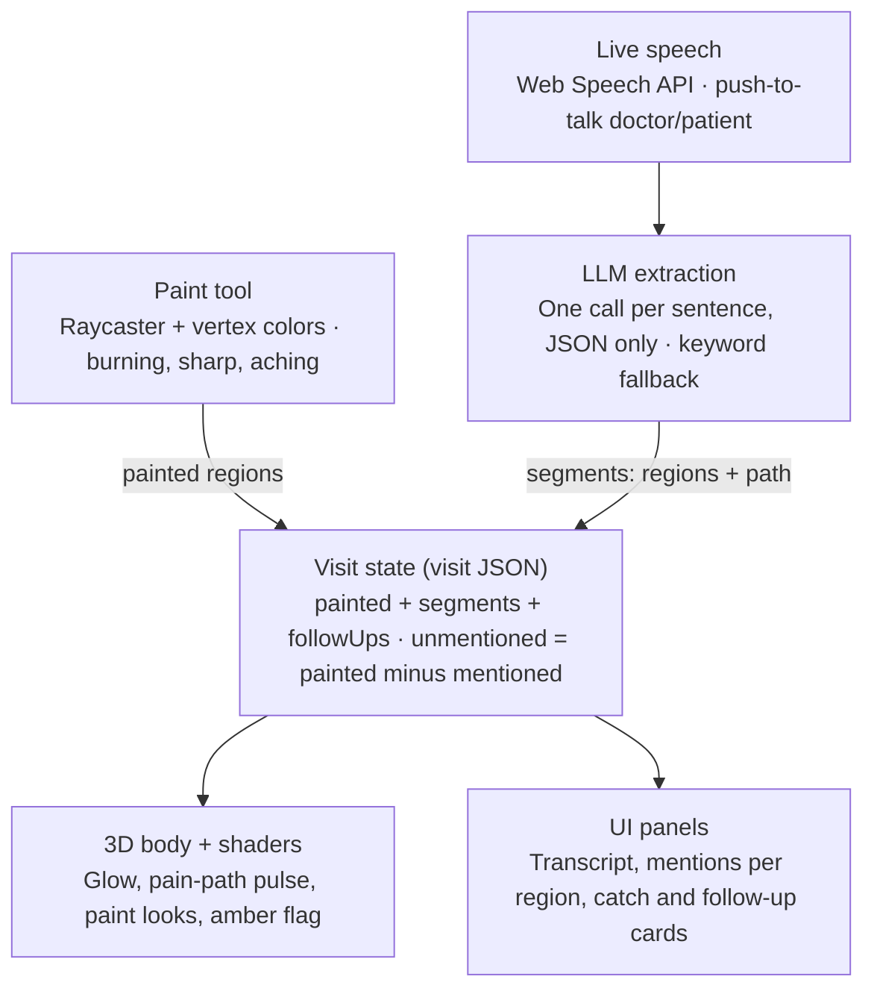

# WhereItHurts: Final Plan for Sundai Hack 150

Nov 22, 2026 · Dinesh Bachchani

**Team:** Dinesh Bachchani and Akash Shridhar Shetty

## Overview

WhereItHurts turns a doctor's visit into a 3D body that listens. The patient paints their pain onto the body before the visit, then two of us role-play the visit live and the body lights up as each body part is mentioned. At the end, any pain the patient painted but nobody talked about stays flagged.

It combines two ideas into one story:

- **Show it:** the patient paints where it hurts on a rotatable 3D body, picking a pain type. Burning, sharp and aching each get their own shader look.

- **Say it:** a live doctor–patient conversation is transcribed, and an LLM maps each sentence to body regions and pain paths. "Starts in my lower back and goes down my left leg" sends a glowing pulse down the leg.

- **Nothing gets lost:** painted regions that never came up in the conversation glow amber at the end, with a card: "You marked your knee, but nobody talked about it."

**One-line pitch:** Show where it hurts, say what it feels like, and never leave a visit with pain nobody talked about.

**Scope rule:** this is a communication and comprehension tool, not a diagnostic tool. It never names a condition. All audio is role-played by the team or volunteers; no real patient data.

## Why this can win

No plan guarantees a win, but this one is built to score on every criterion the event lists and to stand apart from the other 15 pitches.

**Against the event's own criteria:**

| Event criterion                              | How WhereItHurts meets it                                                                                  |
|----------------------------------------------|------------------------------------------------------------------------------------------------------------|
| A clear question                             | When a patient leaves a visit, what pain went undiscussed?                                                 |
| Simple rules, one sentence                   | A body part lights up when it is painted or spoken about; painted but never spoken stays flagged.          |
| Inputs people can change, results right away | Paint by dragging, speak live, scrub the timeline, click a region. Every input changes the body instantly. |
| Smooth at 60fps on a laptop                  | One low-poly body, a few shaders, no physics engine.                                                       |
| Live at a public URL, repo, recording        | Static site on Vercel, no server needed on stage except one LLM call per sentence.                         |
| Keeps working after the demo                 | A real product path: pre-visit intake for clinics and PT practices.                                        |

**Against the other pitches in the room:**

- **It's the only patient-facing health tool.** The other health ideas are a rhinoplasty clinic website and NeoLiver Scout; neither puts a live conversation on a 3D body.

- **The room is mostly games and worlds** (racing, gardening, album tours, livestream worlds, destructive terrain). A tool solving a problem everyone has felt at a doctor's office stands out.

- **It uses the audience.** Inviting a judge to paint their own pain and say one line turns spectators into users, which most demos can't do.

- **The 3D is essential, not decoration.** Painting wraps around the back and sides of a body you rotate, and the pain-path pulse travels through 3D space.

**The one honest gap:** it is not a physics simulation like crystals or traffic. Our answer: the event also asks for things people can see and play with, and its "science and teaching" track fits a tool that visualizes how pain is communicated. Lean on the live interaction; never call it a simulation.

## Features

Five must-haves make the full story work; everything else is cut first if time runs short.

**Must-haves (the demo fails without these):**

1.  **Paint your pain.** Rotate the body, pick burning, sharp or aching, and drag to paint. Each type has its own shader: burning flickers red-orange, sharp shows bright crackling spikes, aching pulses slowly in deep purple.

2.  **Live voice lights the body.** Each spoken sentence is transcribed and mapped to regions. The mentioned region glows in the speaker's color (doctor blue, patient orange).

3.  **Pain-path pulse.** When a sentence describes movement ("starts in my back and goes down my leg"), a pulse of light travels along that path. This is the hero shot and gets the most polish.

4.  **Unmentioned pain flag.** When the visit ends, painted regions never spoken about glow amber, with a card per region: "You marked your knee, but nobody talked about it."

5.  **Click a region to hear it.** Click the lower back to see every mention with its transcript line, and replay that moment.

**Nice-to-haves (add after the midday checkpoint):**

- **Timeline scrubber:** drag to replay the visit, with the body and transcript updating together.

- **Follow-up cards:** "Schedule a follow-up in two weeks" becomes a clickable card that jumps to that line.

- **Voice-reactive ripple:** a faint ripple across the skin follows the speaker's volume.

- **Visit summary:** a one-screen recap of painted regions, mentioned regions and follow-ups the patient can keep.

**Cut on purpose:** diagnosis of any kind, nerve-pathway overlays (no ready dataset), multiple visits over time (stretch goal only).

## Hero moments and demo run of show

The demo runs 2 minutes 30 seconds with three people: one narrates, two act as doctor and patient, and the patient also drives the laptop.

**The three moments judges will remember:**

- **The pulse:** the patient says "it starts in my lower back and goes down my left leg," and light travels down the leg in real time.

- **The catch:** the visit ends, and the left knee the patient painted glows amber: nobody talked about it.

- **The judge's turn:** a judge paints one spot and says one sentence, and the body responds to them.

**Run of show:**

1.  **0:00 – Problem (narrator).** "Patients forget to mention symptoms, and forget what the doctor said. You walk out, and the pain you came in with never came up."

2.  **0:15 – Paint (patient).** Rotate the body, paint the lower back as aching, the left leg as sharp, and the left knee as aching.

3.  **0:35 – Live visit (doctor and patient).** Role-play the script. The body lights up line by line; the pulse runs down the leg on line 4.

4.  **1:20 – The catch.** Click "End visit." The knee glows amber with the card "You marked your left knee, but nobody talked about it."

5.  **1:40 – Click to hear it.** Rotate, click the lower back, show its four mentions, replay the patient's own words.

6.  **2:00 – Judge's turn.** "Want to try? Paint where something has bothered you and tell the doctor about it." One sentence, live.

7.  **2:20 – Close (narrator).** "Show where it hurts, say what it feels like, and never leave a visit with pain nobody talked about."

**Rehearse the run three times before 8pm,** and once in the actual demo room to check mic and noise.

## Architecture

Two inputs, painting and live speech, write into one visit state; the 3D body and the UI only read from it, so nothing drifts out of sync.



WhereItHurts architecture · 2 inputs, 1 state, 2 views

The only network call is the LLM extraction per sentence. If it fails or is slow, the keyword dictionary fills in so the body still reacts.

## Data model

One visit JSON object holds everything; every part of the app reads from and writes to it. Lock this format in the first 30 minutes so the 3D, voice and UI owners can work in parallel.

```json
{
  "visitId": "live-01",
  "speakers": {
    "doctor": { "color": "#4FC3F7" },
    "patient": { "color": "#FFB74D" }
  },
  "painted": [
    { "region": "lower_back", "type": "aching", "intensity": 0.6 },
    { "region": "left_leg", "type": "sharp", "intensity": 0.8 },
    { "region": "left_knee", "type": "aching", "intensity": 0.4 }
  ],
  "segments": [
    {
      "id": "s4",
      "speaker": "patient",
      "start": 14.2,
      "end": 18.9,
      "text": "It starts in my lower back and goes down my left leg.",
      "regions": ["lower_back", "left_leg"],
      "path": ["lower_back", "left_leg"]
    }
  ],
  "followUps": [
    { "id": "f1", "text": "Follow-up visit in two weeks", "segmentId": "s9" }
  ]
}
```

**Field rules:**

- `painted` is written by the paint tool: one entry per region painted, keeping the latest type.

- `segments` grow live: each finished sentence is appended after the LLM returns its regions.

- `regions` lists every body part a sentence mentions; the click index is built from it.

- `path` is set only when the speaker describes movement, in order; it drives the pulse.

- Left and right always mean the patient's side, never the viewer's.

- Unmentioned pain = painted regions minus the union of all segment regions. That one line of code is the whole "catch" feature.

**Region ids for the MVP (6):** `head`, `neck`, `lower_back`, `left_leg`, `left_knee`, `right_shoulder`. Add more only after the demo works end to end.

## Role-play script

The live visit runs on a 9-line script, about 40 seconds at a normal pace. Before it starts, the patient paints three regions: lower back (aching), left leg (sharp) and left knee (aching). The knee is deliberately never mentioned, so the catch fires.

| #   | Speaker | Line                                                        | What happens on the body                          |
|-----|---------|-------------------------------------------------------------|---------------------------------------------------|
| 1   | Doctor  | What brings you in today?                                   | Doctor color ripple only                          |
| 2   | Patient | My lower back has been hurting for about three weeks.       | Lower back glows                                  |
| 3   | Doctor  | Does the pain stay in one place?                            | Lower back stays lit                              |
| 4   | Patient | No, it starts in my lower back and shoots down my left leg. | Pulse travels lower back to left leg              |
| 5   | Doctor  | Any headaches or neck stiffness?                            | Head and neck glow                                |
| 6   | Patient | Some headaches in the morning.                              | Head stays lit                                    |
| 7   | Doctor  | Let's start physical therapy and heat on your lower back.   | Lower back glows                                  |
| 8   | Doctor  | And let's schedule a follow-up in two weeks.                | Follow-up card appears                            |
| 9   | Patient | Okay, thank you.                                            | Patient ripple only; visit ends, knee turns amber |

**Rules for the script:**

- The lower back comes up in lines 2, 3, 4 and 7, so clicking it shows four mentions.

- Line 4 uses "shoots down," not the exact words from the planning doc, to prove the LLM handles natural phrasing rather than keywords.

- The doctor gives general care steps only; no condition is named anywhere.

- Record one clean take of the script early as the backup video track.

## Tech stack and assets

Everything runs in the browser except one LLM call per sentence. No dataset is needed: the patient's painting and the live conversation are the data.

| Layer                  | Tool                                                                           | Used for                                                                                |
|------------------------|--------------------------------------------------------------------------------|-----------------------------------------------------------------------------------------|
| Build                  | Vite + React (or vanilla JS)                                                   | Fast dev server, one-page app, deploy to Vercel                                         |
| 3D                     | Three.js, OrbitControls, Raycaster                                             | Render and rotate the body, find where the mouse hits                                   |
| Painting               | Raycaster + per-vertex colors                                                  | Paint directly on the mesh; no UV unwrapping needed                                     |
| Shaders                | ShaderMaterial, EffectComposer + UnrealBloomPass                               | Pain-type looks, region glow, pain-path pulse, bloom                                    |
| Live speech            | Web Speech API (Chrome)                                                        | Live transcription; speaker set by a Doctor/Patient push-to-talk button                 |
| Understanding          | One LLM call per finished sentence, JSON-only reply                            | Sentence → regions, path, follow-up                                                     |
| Fallback understanding | Keyword dictionary in JS                                                       | Used if the LLM call fails or is slow                                                   |
| Audio                  | MediaRecorder + Web Audio API AnalyserNode                                     | Record the live visit for click-to-hear; mic volume for the voice ripple (nice-to-have) |
| Body model             | Stylized low-poly human, split into 6 named meshes in Blender, exported as GLB | Clickable, paintable regions                                                            |

**Body model options, in order of preference:**

1.  A stylized low-poly human, split in Blender into the 6 region meshes. Fastest and reads best on a projector.

2.  BodyParts3D or Z-Anatomy for realistic anatomy. Your friend's plan notes both are under Creative Commons share-alike terms; confirm the license and credit them on the final slide.

3.  Fallback if no one knows Blender: capsules and boxes for each region, styled with the glow shader.

**Verify in the first 30 minutes, before writing features:**

- [ ] Web Speech API transcribes in Chrome on the demo laptop, in the actual room

- [ ] One LLM call returns valid JSON regions for a test sentence in under 1.5 seconds

- [ ] The GLB body loads and the raycaster returns the right region name on click

- [ ] Vertex painting shows color on the body mesh

## Team roles

Four roles; with three people, merge UI and pitch into the 3D scene role. Owners other than Akash are suggestions to confirm at team formation.

| Role                    | Owner        | Owns                                                                                                    | Done when                                                                          |
|-------------------------|--------------|---------------------------------------------------------------------------------------------------------|------------------------------------------------------------------------------------|
| Voice and understanding | Dinesh       | Web Speech API, push-to-talk speaker toggle, LLM prompt and JSON parsing, keyword fallback, visit state | Saying line 4 live adds a segment with the right regions and path within 2 seconds |
| Shaders                 | Open         | Pain-type looks, region glow, pain-path pulse, amber flag, bloom                                        | Pulse runs lower back to left leg and looks good on a projector                    |
| 3D scene and painting   | Open         | Body model prep, lighting, camera, region clicks, vertex painting                                       | Painting the knee writes a painted entry; clicking a region returns its id         |
| UI and pitch            | Akash Shetty | Transcript panel, mention list, catch cards, run of show, slides, backup video                          | End visit shows the knee card; full run of show rehearsed                          |

**Handoff contracts:**

- The visit JSON is the contract between all four roles; agree on it before anyone writes features.

- The shader owner exposes five functions: `glow(regionId, color)`, `pulse(path)`, `paintLook(regionId, type)`, `flag(regionId)` and `ripple(color, volume)`. The scene owner calls them.

- The voice owner exposes one event: `onSegment(segment)`, fired when a sentence's regions come back. Everything else listens to the visit state.

Akash was listed for voice in his original plan; swap with Dinesh if he prefers, but whoever takes voice owns the riskiest piece and should start with the 30-minute checks.

## Timeline

The rule for the day: a rough version of the whole flow works by 14:00; polish comes after, never before. Times follow the event schedule (pitching at 10:50, lunch at 14:00, demos at 20:00).

| Time | Phase | What happens |
| --- | --- | --- |
| 10:50–11:30 | Pitch, team, lock the contract | Pitch at team formation, agree the visit JSON, run the four 30-minute checks |
| 11:30–14:00 | Rough end-to-end | Body loads, painting writes regions, one spoken line lights a region |
| **14:00** | **Midday checkpoint** | **Paint a region, speak a line, see both on the body** |
| 14:00–15:00 | Lunch and check-in | Fix whatever failed the checkpoint; cut a nice-to-have if it slipped |
| 15:00–17:30 | Core features | Pain-path pulse, unmentioned-pain flag, click-to-hear mentions, pain-type shaders |
| 17:30 | Feature freeze | The full run of show works once, end to end |
| 17:30–19:00 | Ship and polish | Deploy to Vercel, record the backup video, polish the pulse; extras only if stable |
| 19:00–20:00 | Rehearse | Three full runs, one in the demo room with the mic and the real noise |
| 20:00 | Demo | 2 minutes 30 seconds, live |

Build day · 6 phases, 3 gates

If the 14:00 checkpoint fails, use lunch to fix it and drop nice-to-haves in the cut order from the risks section.

## Pain painting in detail

Painting is the "show it" half of the idea: the patient marks where it hurts and what it feels like before the visit starts, and those marks become the checklist the conversation is compared against.

**How the patient uses it:**

1.  The app opens in **Paint mode** with the body facing front and a legend on the side: Burning, Sharp, Aching, Eraser.

2.  The patient picks a pain type, then **left-drags on the body to paint**. Right-drag rotates the body and scroll zooms, so painting and rotating never fight each other.

3.  Painting the same spot again **raises its intensity** (three levels: mild, moderate, strong), shown as brighter, stronger animation.

4.  Hovering a painted area shows a label in the patient's terms: "Left knee · aching · moderate." Left and right are always the patient's side.

5.  The patient clicks **Start visit**. Painting locks, the body switches to Visit mode, and live voice takes over.

6.  When the patient clicks **End visit**, the catch runs and unmentioned painted regions turn amber.

**How each pain type looks (one shader, three styles):**

| Pain type                 | Color         | Motion                                    | Why it reads                                       |
|---------------------------|---------------|-------------------------------------------|----------------------------------------------------|
| Burning                   | Red to orange | Fast, irregular flicker like heat         | Feels hot without words                            |
| Sharp                     | White-yellow  | Brief bright crackles that jump around    | Feels sudden and stabbing                          |
| Aching                    | Deep purple   | Slow, steady pulse, about once per second | Feels dull and constant                            |
| Unmentioned (after visit) | Amber         | Steady glow with a soft outline           | Separate from pain types, so it reads as a warning |

**How it works under the hood:**

- The body mesh carries two extra values per vertex: pain type (0 = none, 1 = burning, 2 = sharp, 3 = aching) and intensity (0 to 1). The shader reads both to draw the styles above.

- While the left mouse button is held, a raycaster finds the hit point on the body; every vertex within the brush radius gets the current type, and its intensity rises by one step, capped at 1.

- Each vertex also belongs to one named region mesh (lower_back, left_knee, …). A region counts as painted once enough of its vertices are painted (start with 15%, tune by eye), and its painted entry takes the type covering most of its painted vertices.

- Every stroke updates the painted list in the visit state, so the UI and the catch always see the latest picture.

- The eraser sets type and intensity back to 0 and recomputes the region.

**The catch logic, in full:**

1.  Collect every region in `painted`.

2.  Collect every region mentioned in any segment's `regions`, by either speaker.

3.  Unmentioned = painted minus mentioned.

4.  For each unmentioned region, draw the amber glow and add a card: "You marked your left knee (aching, moderate), but nobody talked about it."

5.  If nothing is unmentioned, show a green card: "Everything you marked came up in the visit." This makes a good second demo run.

**Fallback if brush painting looks rough on the low-poly mesh:** click a region to paint the whole region with the chosen type, clicking again to raise intensity. The shaders, the catch and the demo stay exactly the same.

## Step-by-step build guide

Follow the phases in order and tick each step as it lands; a phase is done only when its done-check passes. Everyone builds against the same mock visit JSON until integration, so no one waits on anyone else.

### Phase 0 · 10:50–11:30 · Everyone together

- [ ] Pitch at team formation and assign the four roles.

- [ ] Create the repo (Vite + React), push it, and have everyone clone and run it.

- [ ] Deploy the empty app to Vercel now, so deployment never surprises you at 19:00.

- [ ] Put the sample visit JSON from the data model in `src/mockVisit.js`; every role builds against it.

- [ ] Run the four 30-minute checks from the tech stack section.

- [ ] Record one clean take of the role-play script on a phone as the backup.

**Done-check:** the app is live at a URL, and all four checks pass.

### Phase 1 · 11:30–14:00 · Rough end-to-end

**Voice and understanding (Dinesh):**

- [ ] Start Web Speech API in continuous mode; show interim words live, and treat each final result as one sentence.

- [ ] Add push-to-talk: hold the Doctor or Patient button (or keys D and P) while speaking; the held button sets the speaker.

- [ ] Write the LLM prompt: give it the 6 region ids, ask for JSON only (regions, path, followUp), and state that left and right mean the patient's side.

- [ ] Test the prompt on all 9 script lines plus 5 unscripted ones ("my calf aches," "it radiates down my leg"); fix the prompt until all pass.

- [ ] Build the keyword dictionary fallback for when the LLM call fails or takes over 2 seconds.

- [ ] Build the visit store with `setPainted`, `addSegment` and an `onSegment` event.

- [ ] Start a MediaRecorder recording when the visit starts, and store each segment's start and end in seconds from that moment. Click-to-hear needs this, because the live visit has no pre-recorded audio.

Done-check: saying line 4 adds a segment with lower_back and left_leg in both regions and path within 2 seconds.

**3D scene and painting:**

- [ ] Load the body GLB (or the capsule fallback); set lights and camera; OrbitControls on right-drag and scroll only.

- [ ] Raycast clicks and log the region id under the mouse.

- [ ] Add the per-vertex pain-type and intensity values, and brush painting on left-drag as described in the painting section.

- [ ] Compute region coverage after each stroke and write the painted list to the store.

Done-check: painting the left knee as aching adds `{ region: "left_knee", type: "aching" }` to painted.

**Shaders:**

- [ ] Build the body ShaderMaterial that reads pain type and intensity and draws burning, sharp and aching.

- [ ] Add `glow(regionId, color)` for spoken mentions.

- [ ] Add the bloom pass and check it on the projector-sized screen.

Done-check: all three pain styles and a doctor-blue glow show on the body at 60fps.

**UI and pitch (Akash):**

- [ ] Lay out the screen: body in the center, pain legend on the left, live transcript on the right, Start visit and End visit buttons.

- [ ] Show transcript lines from the store, each in its speaker's color, with interim words in grey.

- [ ] Switch between Paint mode and Visit mode on Start visit.

- [ ] Draft the slides: problem, demo, how it works, credits.

Done-check: lines spoken during a visit appear in the transcript in the right colors.

**Integration, 13:30–14:00 (everyone):** connect onSegment to glow, connect painting to the store, then run the checkpoint.

**14:00 checkpoint:** paint a region, speak a line, and see both on the body.

### Phase 2 · 15:00–17:30 · Core features

- [ ] **Shaders:** build `pulse(path)`, a band of light moving from the first region's center to the last over about 1.5 seconds, repeating twice.

- [ ] **Shaders:** build `flag(regionId)`, the amber unmentioned glow.

- [ ] **3D scene:** precompute a center point for each region as the pulse's waypoints; add hover labels ("Left knee · aching · moderate").

- [ ] **3D scene:** switch painting to the click-a-region fallback now if brush strokes look rough.

- [ ] **Voice:** fire pulse whenever a segment has a path; show the transcript line immediately and the glow when the LLM returns.

- [ ] **Voice:** play a segment's slice of the MediaRecorder recording on request.

- [ ] **UI:** on End visit, run the catch and show one card per unmentioned region, or the green all-clear card.

- [ ] **UI:** clicking a region lists its mentions; clicking a mention plays that moment and highlights its transcript line.

**17:30 feature freeze:** the full run of show works once, end to end, with no code changes during the run.

### Phase 3 · 17:30–19:00 · Ship and polish

- [ ] Deploy the final build to Vercel and test the public URL on a second laptop.

- [ ] Record the backup screen video of one full run of show.

- [ ] Polish the pulse first, since it is the hero shot.

- [ ] Add nice-to-haves only if everything is stable, in this order: visit summary, follow-up card, timeline scrubber, voice ripple.

- [ ] Write the README: what it is, how to run it, the region ids, credits for any body model.

- [ ] Finish the slides, including the body model credit if you used BodyParts3D or Z-Anatomy.

### Phase 4 · 19:00–20:00 · Rehearse

- [ ] Run the full show three times; time it to 2 minutes 30 seconds.

- [ ] Do one run in the demo room with the real mic and noise.

- [ ] Practice the judge's turn with a teammate who hasn't seen the script.

- [ ] Rehearse the switch to the backup video, in case live fails.

- [ ] Charge the laptop, use Chrome, close other tabs, turn notifications off.

**20:00 demo.**

## Risks and fallbacks

The biggest risk is live speech failing on stage; every other risk has a cheap fallback.

| Risk                                                | Fallback                                                                                                           |
|-----------------------------------------------------|--------------------------------------------------------------------------------------------------------------------|
| Live speech fails in a noisy room                   | Use a headset mic; if it still fails, type the lines or play the recorded take. The painting and catch still work. |
| LLM call is slow or returns bad JSON                | Show the transcript line at once and light the body a beat later; on error, use the keyword dictionary.            |
| Chrome speech recognition can't tell speakers apart | Push-to-talk: the speaker holds their own Doctor or Patient button while talking.                                  |
| Body model takes too long to split                  | Capsules and boxes for the 6 regions, styled with the glow shader.                                                 |
| Vertex painting looks blocky on a low-poly mesh     | Paint whole regions on click instead of brush strokes; keep the pain-type shaders.                                 |
| Pain-path pulse looks bad                           | Light the regions in sequence with a 300 ms delay, then keep polishing.                                            |
| Glow, paint and ripple look muddy together          | Drop the ripple first; show speaker color on the transcript only.                                                  |
| Wifi or laptop fails on stage                       | Play the backup screen recording made in the last hour.                                                            |
| A judge asks whether it diagnoses                   | No. It helps patients say everything and remember what was said. No condition is ever named.                       |

**Cut order if the midday checkpoint slips:** voice ripple → timeline scrubber → follow-up card → visit summary. The paint, live voice, pulse, catch and click-to-hear features stay no matter what.

## Pitch, judge Q&A and stretch goals

**10:50 team-formation pitch (30 seconds):**

"You've walked out of a doctor's office and realized you forgot to mention something. We're building a 3D body you paint your pain onto, then it listens to the visit live and lights up as each body part comes up. At the end, anything you painted that nobody talked about stays glowing. We need a shader person and a Three.js person."

**Likely judge questions:**

| Question                             | Answer                                                                                                                |
|--------------------------------------|-----------------------------------------------------------------------------------------------------------------------|
| Does it diagnose?                    | No. It helps patients say everything and remember what was said. No condition is ever named.                          |
| Does it only work on your script?    | No. Try it: paint a spot and say any sentence. The LLM reads natural phrasing, not keywords.                          |
| Why 3D and not a 2D body chart?      | Pain wraps around the body: back, sides, joints. Painting and pain paths need a body you can rotate.                  |
| What about privacy with real visits? | Today it's role-play only. A real version would run with patient consent and keep recordings on the patient's device. |
| Who would use it?                    | Clinics and physical therapy practices as pre-visit intake, and patients reviewing a visit at home.                   |
| What happens after today?            | Pilot it as a pre-visit intake page a PT practice sends patients before their first appointment.                      |

**Stretch goals, in priority order:**

- [ ] Pain intensity from words ("mild," "sharp," "unbearable") mapped to glow brightness

- [ ] More regions: chest, stomach, both arms, both shoulders

- [ ] Visit summary card the patient can save or share

- [ ] Compare two visits on one body to see what changed

- [ ] Multilingual input: the patient speaks in their own language, the doctor's view stays in English
