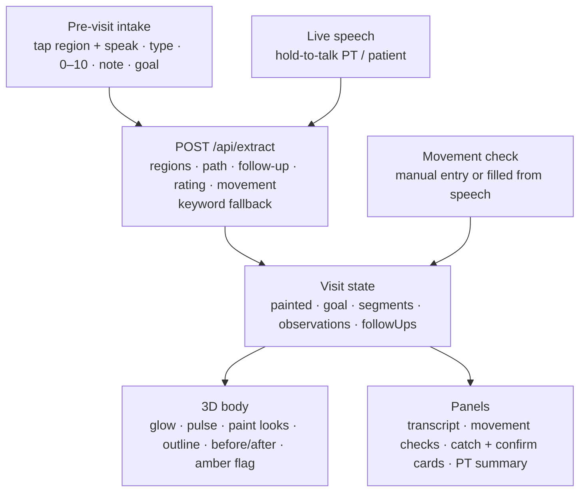

# WhereItHurts: Final Plan for Sundai Hack 150 (v2, physical therapy)

Nov 22, 2026 · Dinesh Bachchani and Akash Shridhar Shetty

v2 narrows the product to physical therapy and adds the movement check, the patient's goal and the PT summary. The first version of this plan is in git history.

## Overview

WhereItHurts puts what the patient feels and what the physical therapist (PT) tests on one 3D body.

- **Show it:** before the visit, the patient taps where it hurts and just says it: "It's a sharp pain, about a six, worse when I lift my arm." The app fills in the pain type, the 0–10 rating and their words. They say their goal the same way. No typing.
- **Say it:** the visit is transcribed live and each body part lights up as it comes up. When the patient describes pain traveling ("it runs from my neck into my shoulder"), a pulse of light follows that path.
- **Test it:** the PT records a movement check: the area they assessed, the movement, and the patient's rating before and after. A Before/After toggle shows the change on the body, and the assessed area gets its own outline labelled "Area assessed by PT."
- **Nothing gets lost:** at the end, anything the patient marked that nobody talked about glows amber, the goal is checked, and the patient confirms or corrects the summary.

**One-line pitch:** Patients feel pain where it hurts. PTs test movements to find what changes it. WhereItHurts puts both on one body, so the patient sees why the PT checked their neck, confirms what changed, and leaves with nothing they marked left unsaid.

**Scope rule:** a communication tool, never a diagnostic one. It never names a condition and never suggests a cause. The app shows only what the patient reported and what the PT chose to assess. All audio is role-played; no real patient data.

## Why PT, and why this design

- Where a patient feels pain is often not where the problem starts. Irritation in the neck, for example, can show up as shoulder or arm symptoms. A PT works that out from the patient's history, how symptoms respond to movement and the exam, never from a body map alone.
- So the app does not draw a "root cause" arrow. It records what the PT tested and how the patient's symptoms changed. That is the observation a PT actually reasons from, and it explains to the patient why the PT looked at their neck.
- The animated pain path is used only when the patient themselves describes pain traveling.

**Who it's for:**

| User | What they get |
|---|---|
| Patient | Point instead of describe; see why the PT tested other areas; confirm the record; nothing marked gets skipped |
| PT | Location, pain type, rating and the patient's goal before walking in; movement checks logged from the conversation; a summary in 10 seconds |
| Clinic | Pre-visit intake and a record the patient has confirmed |

**How it differs from medical scribes** (Abridge, Nuance DAX): scribes write notes for the clinician. WhereItHurts is for the patient and the PT together: it checks the visit against what the patient wanted to say, and the patient confirms what changed.

## Against the event's criteria

| Event criterion | How WhereItHurts meets it |
|---|---|
| A clear question | When a patient leaves a PT visit, what pain went undiscussed, and what changed? |
| Simple rules | A region lights up when it is marked or spoken about; marked but never spoken stays flagged; a movement check shows before and after |
| Inputs people can change, results right away | Tap to mark, speak live, flip Before/After, click a region. Every input changes the body instantly |
| Smooth at 60fps | One low-poly body, a few shaders, no physics engine |
| Live at a public URL, repo, recording | Vercel, plus the backup video |
| Keeps working after the demo | PT intake and visit record for clinics |

**The honest gap:** it is not a physics simulation. It fits the "science and teaching" track: it shows patients how pain in one place relates to what the PT tests. Lean on the live interaction; never call it a simulation.

## Features

**Must-haves (the demo fails without these):**

1. **Mark your pain by voice.** Tap a region; the body shows it's listening; the patient describes it in their own words. Speech fills in the pain type (burning, sharp, aching), the 0–10 rating and a note with what they said. Tap-and-pick buttons stay as the fallback when speech fails. Each type has its own shader.
2. **Your goal, spoken.** "What would you like to be able to do again?" The patient answers out loud; it stays pinned beside the body for the whole visit.
3. **Live voice lights the body.** Each sentence lights its regions in the speaker's color (PT blue, patient orange).
4. **Pain-path pulse.** When the patient describes pain traveling, light runs along that path. The hero shot.
5. **Movement check.** The PT records area assessed + movement + symptom region + before and after ratings + response (better, worse, same, moved, unsure) + the patient's words. The assessed area gets an outline labelled "Area assessed by PT." A Before/After toggle switches the body between the two ratings.
6. **End of visit.** Unmentioned marked regions glow amber with a card each; the goal is checked ("Did you talk about putting plates on the top shelf?"); the patient confirms or corrects each movement check: "During the head turn to the left, you said your right shoulder ache went from 5/10 to 2/10. Does that match what you felt?"
7. **PT summary card.** Goal, marked regions with type and rating, movement checks, missed items, follow-ups. Readable in 10 seconds.

**Nice-to-haves, in build order after the freeze-critical items:**

- Movement check filled in from speech: the LLM picks up the movement, area and ratings from what the PT and patient say, so the PT doesn't type. Manual entry always works as the fallback.
- "Compare another movement": more than one movement check, as a list.
- Click a region to hear every mention of it.
- Hover labels: "Right shoulder · aching · 5/10."
- Bloom pass.

**Cut for today, kept for the pitch's "what's next":** progress across sessions (pain moving back toward the spine as therapy works), Spanish input, voice ripple, timeline scrubber, brush painting (tap a region instead).

**Out of scope, and the answer if asked:** safety screening for warning signs. "A clinical version would include standard intake screening; today's build covers communication only."

## Demo run of show (2:30)

Three people: a narrator, a PT and a patient. The patient drives the laptop.

**Hero moments:**

- **The pulse:** "it runs from my neck down into my shoulder," and light runs from the neck to the shoulder.
- **The change:** the PT checks the neck, the patient's shoulder goes from 5 to 2, and the patient flips Before/After: "Yes, that's what changed."
- **The catch:** the knee the patient marked glows amber; nobody talked about it.

| Time | Who | What happens |
|---|---|---|
| 0:00 | Narrator | Problem: you leave a visit with pain nobody discussed, and you're not sure why the PT tested somewhere else |
| 0:15 | Patient | Taps the right shoulder: "It aches, about a five, when I reach up." Taps the left knee: "Dull ache, maybe a three." Says the goal: "Put plates on the top shelf." |
| 0:35 | PT + patient | Script lines 1–6; the pulse on line 4 |
| 1:05 | PT + patient | Lines 7–8: the movement check; the neck outline appears, the shoulder drops to 2/10 |
| 1:25 | Patient | Flips Before/After: "Yes, that's what changed" |
| 1:40 | PT + patient | Lines 9–11, then End visit |
| 1:50 | Patient | Knee glows amber; goal shows as discussed; patient confirms the movement check |
| 2:05 | Narrator | PT summary card on screen |
| 2:20 | Narrator | Close with the one-line pitch |

Rehearse three times before 20:00, once in the demo room with the real mic.

## Role-play script

Before it starts, the patient marks the right shoulder (aching, 5/10) and the left knee (aching, 3/10), and sets the goal. The knee is never mentioned, so the catch fires.

| # | Speaker | Line | What happens |
|---|---|---|---|
| 1 | PT | What brings you in today? | PT color only |
| 2 | Patient | My right shoulder aches when I reach up to put plates away. | Right shoulder glows; goal marked as discussed |
| 3 | PT | Does it stay in one place? | Right shoulder stays lit |
| 4 | Patient | Sometimes it runs from my neck down into my shoulder. | **Pulse: neck → right shoulder** |
| 5 | PT | How bad is the shoulder right now, zero to ten? | Right shoulder glows |
| 6 | Patient | About a five. | Movement check opens with before = 5 |
| 7 | PT | Let me check your neck. Slowly turn your head to the left. | Neck outlined "Area assessed by PT"; movement = turn head left |
| 8 | Patient | Oh, the shoulder feels better. Maybe a two. | After = 2, response = better |
| 9 | PT | Let's work on your neck and shoulder, with exercises at home. | Neck and shoulder glow |
| 10 | PT | And let's book a follow-up in two weeks. | Follow-up card |
| 11 | Patient | Okay, thanks. | Visit ends; knee turns amber |

**Script rules:**

- Line 4 is the patient's own description of travel, so the pulse is allowed. Nobody calls the neck the cause.
- The PT gives general care steps only; no condition is named anywhere.
- If speech fill-in for the movement check isn't ready, the PT taps the neck and enters the movement and ratings by hand during lines 7–8.
- Record one clean take early as the backup video.

## Architecture

Two inputs (tapping and speech, both before and during the visit) write into one visit state; the body and the panels only read from it.



## Data model (the contract)

Shared by everyone. Changing it means telling each other first. Changes from v1: `intensity` is now 0–10, and `goal` and `observations` are new.

```json
{
  "visitId": "live-01",
  "speakers": {
    "pt": { "color": "#4FC3F7" },
    "patient": { "color": "#FFB74D" }
  },
  "goal": { "text": "Put plates on the top shelf", "discussed": false },
  "painted": [
    { "region": "right_shoulder", "type": "aching", "intensity": 5, "note": "It aches, about a five, when I reach up." },
    { "region": "left_knee", "type": "aching", "intensity": 3, "note": "Dull ache, maybe a three." }
  ],
  "segments": [
    {
      "id": "s4",
      "speaker": "patient",
      "start": 14.2,
      "end": 17.9,
      "text": "Sometimes it runs from my neck down into my shoulder.",
      "regions": ["neck", "right_shoulder"],
      "path": ["neck", "right_shoulder"]
    }
  ],
  "observations": [
    {
      "id": "o1",
      "movement": "Turn head to the left",
      "assessedRegion": "neck",
      "symptomRegion": "right_shoulder",
      "before": 5,
      "after": 2,
      "response": "better",
      "quote": "Oh, the shoulder feels better. Maybe a two.",
      "segmentIds": ["s6", "s7", "s8"],
      "confirmed": null
    }
  ],
  "followUps": [
    { "id": "f1", "text": "Follow-up in two weeks", "segmentId": "s10" }
  ]
}
```

**Field rules:**

- `painted`: one entry per region, latest wins; `intensity` is an integer 0–10; `note` holds the patient's own words from the intake (optional).
- `segments`: appended live as each sentence's regions come back.
- `path`: set only when the speaker describes pain moving, in order. Drives the pulse.
- `observations[].response`: one of `better`, `worse`, `same`, `moved`, `unsure`. `moved` means the symptom changed location; keep the patient's words in `quote`.
- `observations[].confirmed`: `null` until the patient answers, then `true` or `false` (with a correction in `quote`).
- `goal.discussed`: set when a segment matches the goal, or by the PT at wrap-up.
- Unmentioned pain = `painted` regions minus every region in any segment's `regions`.
- Left and right always mean the patient's side.
- The speaker role changes from `doctor` to `pt`; `backend/app/constants.py` `SPEAKER_ROLES` changes with it.

**Region ids (7):** head, neck, upper_back, lower_back, left_leg, left_knee, right_shoulder. Keep `src/regions.js` and `backend/app/constants.py` in sync.

**Spine regions:** neck, upper_back and lower_back are the cervical, thoracic and lumbar spine. The UI labels them with both words, "Lower back (lumbar spine)" (`regionLabel()` in `src/regions.js`), so the patient learns the PT's term and the PT sees which level was marked. The 3D body shows a spine line on the back, one vertebra per level, lit with its region, so "Area assessed by PT" can outline a spine section.

**If ahead after the 17:30 freeze:** hips and the other shoulder and knee.

## Contract functions

- **Dinesh (body) exposes:** `glow(region, color)`, `pulse(path)`, `paintLook(region, type, intensity)`, `flag(region)`, `outline(region, label)`, `showRatings(observation, "before" | "after")`, `onRegionClick(callback)`.
- **Akash (brain) exposes:** `setPainted(list)`, `setGoal(text)`, `addSegment(segment)`, `onSegment(callback)`, `addObservation(obs)`, `confirmObservation(id, confirmed, correction?)`, `endVisit()` returning `{ unmentioned, goalDiscussed, observations }`, `playSegment(id)`.
- **`/api/extract` grows three optional fields:** `pain_type` (burning, sharp or aching, when the speaker describes the feeling), `rating` (0–10, when a number is said about pain) and `movement` (short text, when the PT names a movement). Everything else stays as is.
- **Intake call:** the frontend sends the tapped region with the sentence, as `{ text, speaker: "patient", region }`. The region comes from the tap, so the LLM only has to find the type, rating and note. Words like "burning", "stabbing", "dull" and "throbbing" map to the three types (keyword fallback too).

## File ownership

- **Akash:** `backend/`, `src/store/`, `src/panels/`.
- **Dinesh:** `src/scene/`, `src/shaders/`, `public/body.glb`.
- **Shared, change only after telling each other:** `src/mockVisit.js`, `src/regions.js`, `src/contract.js`, `docs/PLAN.md`.

## Task split (from 13:00)

**Shared:**

| Time | Task | Done when |
|---|---|---|
| 13:00–13:15 | Agree on v2: contract, script, roles | Both can recite the new fields |
| 13:15 | Update `src/mockVisit.js` to the v2 contract | Both build against it |
| 13:45–14:00 | Integration 1: `onSegment` → glow, tapping → `setPainted` | Mark a region, say a line, both show on the body |
| 17:30 | Feature freeze run | Full run of show once, no code changes |
| 19:00–20:00 | Rehearse three times, once in the room | Fits in 2:30 |

**Dinesh: the body**

| # | Time | Task | Done when |
|---|---|---|---|
| D3 | 13:00–13:30 | `glow(region, color)` from mock segments | Mock segments light the right regions |
| D4 | 13:30–13:45 | `onRegionClick` exposed through the contract | Akash's panel receives the clicked region |
| D5 | 15:00–15:45 | Intake on the body: tap selects a region and shows a listening highlight; the result (type, rating) shows on the body; tap-and-pick fallback buttons | Tapping the knee and speaking adds it to `painted` |
| D6 | 15:45–16:15 | Pain-type shader: burning, sharp, aching, brightness by intensity | All three run at 60fps |
| D7 | 16:15–17:00 | `pulse(path)`, the hero shot | Light runs neck → right shoulder |
| D8 | 17:00–17:30 | `flag(region)` amber, `outline(region, label)` for "Area assessed by PT" | Knee amber; neck outlined with its label |
| D9 | 17:30–18:15 | `showRatings` + the Before/After toggle on the body; hover labels | Toggle flips the shoulder between 5/10 and 2/10 |
| D10 | 18:15–19:00 | Final Vercel deploy, backup video | Public URL works; video saved |

**Akash: the brain**

| # | Time | Task | Done when |
|---|---|---|---|
| A1 | 13:00–13:45 | Live speech path: hold-to-talk PT/patient, one sentence → `/api/extract` → `addSegment` | Saying line 4 adds a segment with neck and right_shoulder in regions and path within 2 s |
| A2 | 13:45–14:00 | Claude call in `_extract_with_llm`, plus `rating` and `movement` fields | Lines 6 and 7 return rating 5 and the movement |
| A3 | 15:00–15:45 | Voice intake: tapped region + one spoken sentence → `/api/extract` with `pain_type`, `rating`, note → `setPainted`; spoken goal → `setGoal`; store: `addObservation`, `confirmObservation` | Tapping the shoulder and saying "it aches, about a five" adds aching 5/10; the spoken goal is pinned |
| A4 | 15:45–16:30 | Movement check panel: manual entry (area via `onRegionClick`, movement, before/after, response) | Entering lines 7–8 by hand creates `o1` |
| A5 | 16:30–17:15 | `endVisit`: amber catch cards, goal check, confirm cards, PT summary card | Knee card, goal card and confirm card appear |
| A6 | 17:15–17:30 | Fill the movement check from speech | Saying lines 6–8 fills `o1` without typing |
| A7 | 17:30–18:15 | Test the prompt on all 11 lines plus 5 unscripted ones | All return correct regions |
| A8 | 18:15–19:00 | Research slide and narration script | Narration fits 2:30 |

Akash's list is longer; if he falls behind, Dinesh takes the PT summary card after D8.

**Check-ins:** two minutes at 14:00, 15:00, 16:30 and 17:30: what's done, what's next, what's blocking.

## Risks and fallbacks

| Risk | Fallback |
|---|---|
| Live speech fails in the room | Headset mic; then type the lines; then the backup video |
| LLM slow or bad JSON | Keyword fallback (already built); show the transcript line at once, light the body a beat later |
| Speech fill-in for the movement check unreliable | PT enters it by hand during lines 7–8; nothing else changes |
| Body model takes too long | Keep the capsule body (already built) |
| Pulse looks bad | Light the regions in sequence, 300 ms apart |
| Outline and glow look muddy together | Outline in a cool neutral color, glow warm; drop bloom first |
| A judge asks "does it diagnose" or "is the neck the cause" | No. It records what the patient reported and what the PT chose to test. The PT decides; the app never names a cause or a condition |

**Cut order if behind:** bloom → hover labels → click-to-hear → "compare another movement" → movement fill-in from speech. Never cut: marking, goal, live lighting, pulse, movement check with Before/After, amber catch, confirm card.

## Judge Q&A

| Question | Answer |
|---|---|
| Does it diagnose? | No. It records what the patient said and what the PT tested. No condition or cause is ever named. |
| Why did the PT check the neck if the shoulder hurts? | That's the point of the feature: the patient sees what was tested and what changed, and confirms it. |
| Only works on your script? | Try it: mark a spot and say any sentence. |
| Why 3D? | Pain wraps around the body, travels between regions, and the PT tests areas other than where it hurts. A flat chart can't show both at once. |
| How is this different from AI scribes? | Scribes write notes for clinicians. This is for the patient and the PT together, and the patient confirms the record. |
| Privacy? | Role-play only today. A real version would need consent and keep recordings on the patient's device. |
| What's next? | Progress across sessions: watch pain move back toward the spine as therapy works. Then pilot as intake at a PT practice. |
